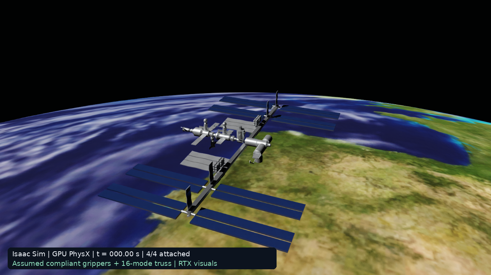
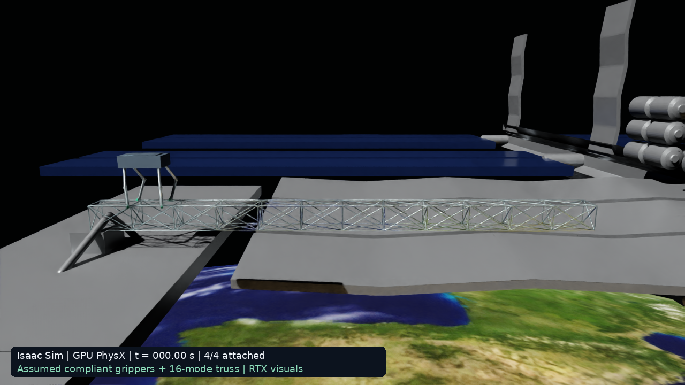

# Spider robot on the ISS: MuJoCo → Isaac Sim

Research code and evidence for a four-legged, four-gripper robot traversing a flexible 6 m truss in an ISS visualization. This repository preserves the October 2026 demonstration and documents how its MuJoCo model was recreated in Isaac Sim 5.1.

**Start with [the supervisor methods document](docs/METHODS.md).** It explains the transfer, MJCF-to-USD adaptations, controller, bidirectional attachment forces, modal structural dynamics, orbital assumptions, GPU execution, camera path, checks and limitations.

The Isaac simulation integrates its own trajectory using GPU PhysX. It does not read the MuJoCo trajectory. Both renderers subsequently visualize their engine's saved results.

## Review and reproduce

- [Methods and supervisor-ready description](docs/METHODS.md)
- [Setup and reproduction commands](docs/REPRODUCE.md)
- [Recorded-data format](docs/DATA_FORMAT.md)
- [Asset sources, attribution and packaging changes](docs/PROVENANCE.md)
- [MuJoCo dynamics source](outputs/canadarm-capture/spider_truss_iss/physics/src/run.py)
- [Isaac dynamics source](outputs/isaac_spider_iss/src/run_physx.py)
- [Exact archived Isaac full-run source](outputs/isaac_spider_iss/source_archive/full_run_script_used.py)
- [MJCF bridge reconstruction](outputs/isaac_spider_iss/src/prepare_bridge.py) and [USD importer](outputs/isaac_spider_iss/src/import_robot.py)
- [Full PhysX numerical checks](outputs/isaac_spider_iss/results/physx_full_checks.json)
- [Short full-rate energy audit](outputs/isaac_spider_iss/results/physx_fullrate_audit_checks.json)

## Full movies and recorded trajectories

Both movies are 136 s at 1280×720/30 fps: a 12 s opening pan, a fixed side view over 120 simulated seconds, and a 4 s hold. Use the file page's Download/Raw control if GitHub does not preview MP4 files.

- [MuJoCo full movie](outputs/canadarm-capture/spider_truss_iss/spider_iss_full_sideview.mp4)
- [Isaac RTX full movie](outputs/isaac_spider_iss/results/isaac_iss_full_sideview.mp4)
- [MuJoCo full trajectory](outputs/canadarm-capture/spider_truss_iss/physics/results/full_mission.npz)
- [PhysX full trajectory](outputs/isaac_spider_iss/results/physx_full.npz)

The archived PhysX run advances 4.70024 m, records 32 release/recapture cycles per leg, and ends with four attachments. Its source-geometry position check has maximum error about 1.17 micrometres. These are numerical checks, not experimental validation or proof of cross-engine equivalence.

## Model limitations

Grippers use assumed translational spring–dashpot attachments, **not resolved finger–rail friction/contact**. The 16-mode truss is linear and fixed at its root. The ISS is visual context with no spacecraft recoil. There are known engine/implementation differences, including base representation, yaw-carrier regularization, control evaluation timing and orbital-force application points. The 3 s full-rate energy audit has approximately 1.7% residual relative to energy range; the 120 s log is too coarse for the same audit. A full-mission energy validation is not claimed.

The export contains source code, parameter files, render assets, selected run data, checks and the two final movies (approximately 233 MB before Git storage). It excludes installed environments, dependency binaries, caches, credentials and the later modular-assembly project. No repository-wide open-source licence is assigned to the user's research code; existing upstream licences and NASA/CSA asset conditions remain applicable. See [provenance](docs/PROVENANCE.md).
